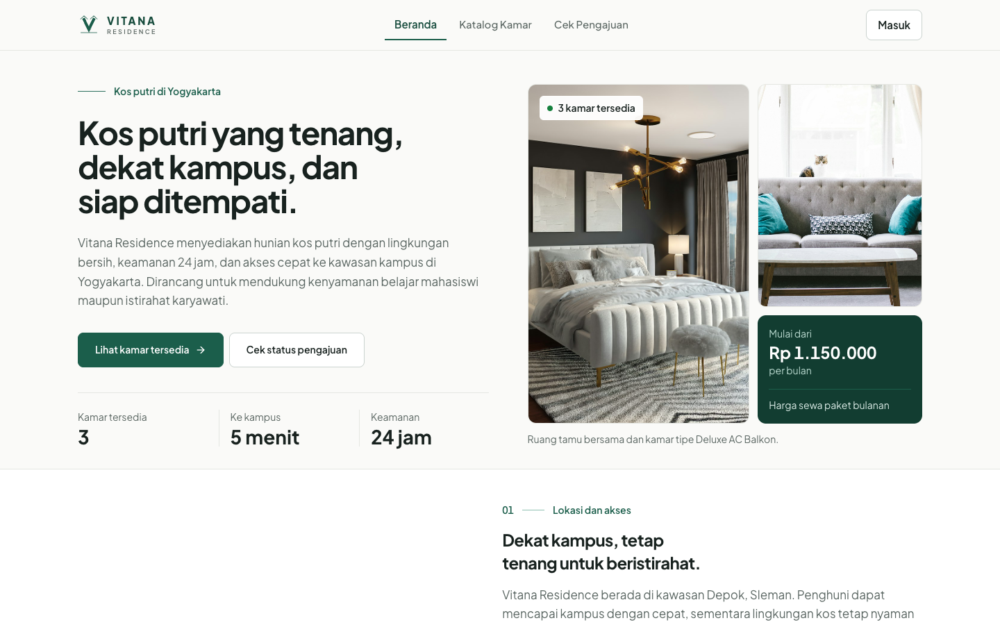
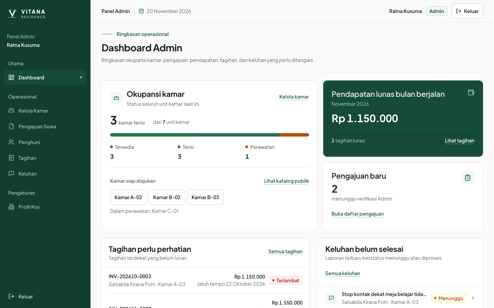
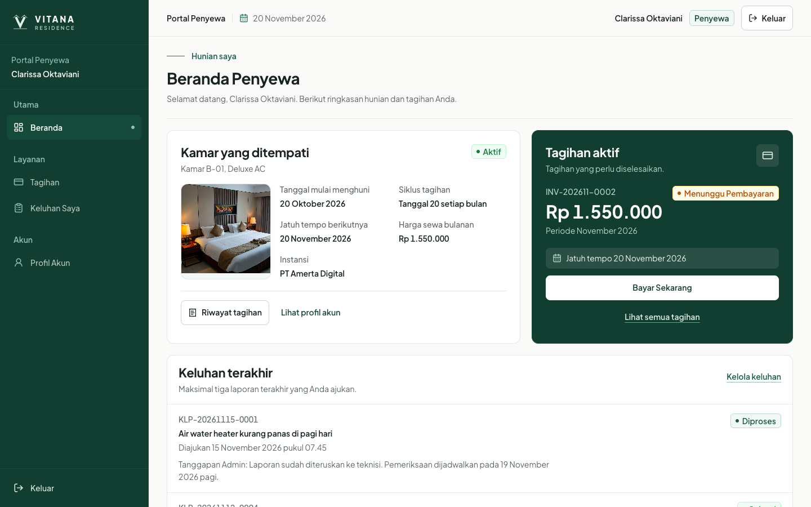
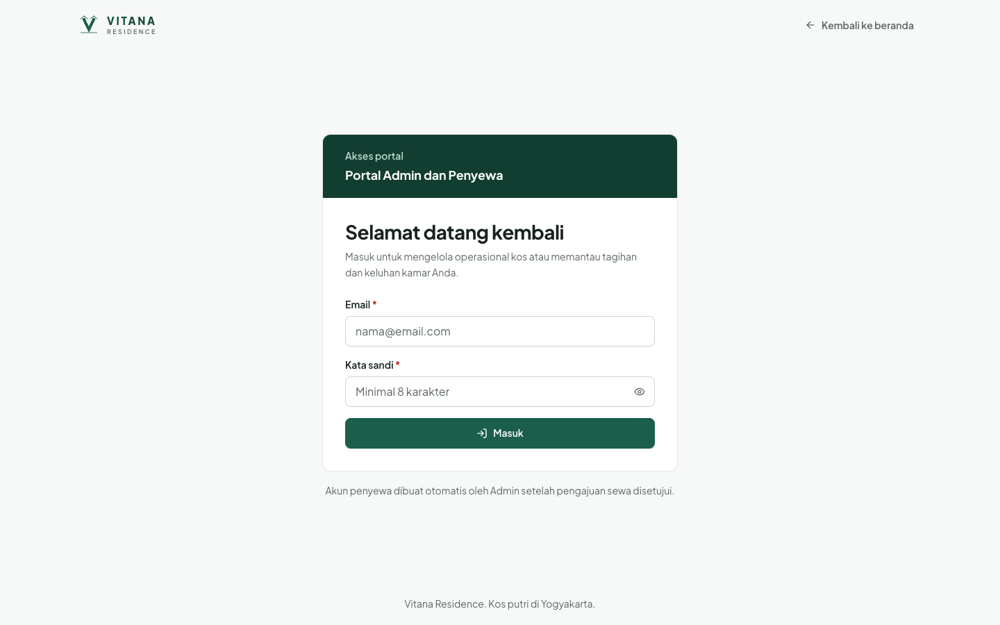

<p align="center">
  
</p>

<h1 align="center">Vitana Residence</h1>

<p align="center">
  Platform company profile, penyewaan, dan operasional kos putri dalam satu aplikasi web.
</p>

<p align="center">
  React 18 · Vite · Tailwind CSS 3 · Laravel 11 · MySQL 8 · Midtrans · Fonnte · Gmail SMTP
</p>

---

## Ringkasan

Vitana Residence adalah platform web untuk satu properti kos putri di Yogyakarta. Aplikasi ini menggabungkan halaman publik untuk calon penyewa, panel Admin untuk operasional harian, dan portal Penyewa untuk tagihan serta keluhan.

Data kamar, status hunian, tagihan, pembayaran, dan keluhan saling terhubung. Status kamar berubah otomatis ketika pengajuan disetujui atau penghuni diproses keluar.

## Status Proyek

- Tahap 1: antarmuka publik, Admin, dan Penyewa selesai.
- Tahap 2: backend Laravel, MySQL, API, autentikasi, pembayaran, notifikasi, dan scheduler selesai.
- Tahap 3: pengujian alur, audit aksesibilitas, pengujian responsif, dan production build selesai.
- Aplikasi siap dikonfigurasi untuk deployment.
- Deploy ke server publik belum dilakukan dari repository ini.

## Tampilan

### Beranda Publik



### Panel Admin dan Portal Penyewa

| Dashboard Admin | Portal Penyewa |
| :---: | :---: |
|  |  |

### Halaman Masuk



## Fitur Utama

### Area Publik

- Profil Vitana Residence, keunggulan lokasi, fasilitas bersama, dan tata tertib.
- Katalog kamar dengan filter status, foto, tipe, lantai, luas, fasilitas, dan harga.
- Detail kamar dengan galeri foto dan aturan sewa.
- Pengajuan sewa online dengan unggah foto KTP atau KTM.
- Kode pengajuan otomatis dengan format `BKG-YYYYMMDD-0001`.
- Pelacakan status pengajuan menggunakan kode pengajuan dan nomor WhatsApp.
- SEO dasar, Open Graph, dan halaman login dengan `noindex`.

### Panel Admin

- Dashboard okupansi, pengajuan baru, pendapatan lunas bulan berjalan, tagihan yang perlu perhatian, dan keluhan aktif.
- CRUD kamar beserta foto utama, galeri foto, fasilitas, harga, dan status.
- Verifikasi pengajuan dengan pratinjau dokumen identitas privat.
- Persetujuan pengajuan membuat akun penyewa, mengubah status kamar, membuat data penghuni, dan menerbitkan tagihan pertama.
- Penolakan pengajuan dengan catatan Admin minimal 10 karakter.
- Daftar penghuni aktif dan riwayat penghuni selesai.
- Proses checkout dengan validasi tunggakan.
- Daftar tagihan, rincian transaksi Midtrans, dan pengingat manual WhatsApp serta email.
- Tindak lanjut keluhan dengan status `menunggu`, `diproses`, dan `selesai`.
- Pengaturan profil kos publik.

### Portal Penyewa

- Ringkasan kamar, tanggal masuk, siklus tagihan, dan jatuh tempo berikutnya.
- Daftar tagihan dan riwayat pembayaran.
- Pembayaran melalui Midtrans Snap.
- Pengajuan keluhan fasilitas dengan foto bukti opsional.
- Pantauan status dan tanggapan Admin.
- Profil akun dan perubahan kata sandi.

### Otomatisasi

- Tagihan bulan berikutnya diterbitkan H-7 sebelum tanggal jatuh tempo siklus penghuni.
- Tagihan yang melewati jatuh tempo otomatis menjadi `terlambat`.
- Pengingat otomatis H-3, H-1, dan H+1 melalui WhatsApp dan email.
- Anti-duplikasi pengingat harian melalui tabel `log_notifikasi`.
- Webhook Midtrans memvalidasi signature SHA-512 dan memakai `lockForUpdate()` agar aman terhadap notifikasi ganda.

## Halaman Utama

### Publik

| Rute | Penjelasan |
| --- | --- |
| `/` | Beranda company profile: hero, lokasi, fasilitas, tata tertib, kamar tersedia, dan kontak. |
| `/kamar` | Katalog seluruh kamar dengan foto, harga, fasilitas utama, dan filter status. |
| `/kamar/:id` | Detail kamar, galeri foto, spesifikasi, aturan sewa, dan formulir pengajuan. |
| `/cek-pengajuan` | Pencarian status pengajuan berdasarkan kode dan nomor WhatsApp. |
| `/login` | Formulir masuk untuk Admin dan Penyewa. |

### Admin

| Rute | Penjelasan |
| --- | --- |
| `/admin/dashboard` | Ringkasan operasional dan daftar pekerjaan yang perlu ditangani. |
| `/admin/kamar` | Tabel seluruh kamar beserta status dan aksi ubah atau hapus. |
| `/admin/kamar/baru` | Formulir kamar baru dengan fasilitas dan foto. |
| `/admin/kamar/:id/edit` | Formulir pembaruan data kamar dan status perawatan. |
| `/admin/pengajuan` | Daftar pengajuan dengan filter status verifikasi. |
| `/admin/pengajuan/:id` | Detail calon penyewa, pratinjau KTP atau KTM, serta aksi Setujui atau Tolak. |
| `/admin/penghuni` | Penghuni aktif, riwayat hunian, siklus tagihan, dan checkout. |
| `/admin/tagihan` | Tagihan bulanan, status Midtrans, dan pengingat manual. |
| `/admin/keluhan` | Daftar keluhan dengan filter status penanganan. |
| `/admin/keluhan/:id` | Detail keluhan, foto bukti, perubahan status, dan tanggapan Admin. |
| `/admin/profil-kos` | Pengaturan informasi publik Vitana Residence. |

### Penyewa

| Rute | Penjelasan |
| --- | --- |
| `/penyewa/dashboard` | Ringkasan kamar, jatuh tempo, tagihan aktif, dan keluhan terakhir. |
| `/penyewa/tagihan` | Daftar tagihan, pembayaran Midtrans, dan riwayat lunas. |
| `/penyewa/keluhan` | Daftar keluhan dan formulir keluhan baru. |
| `/penyewa/profil` | Data pribadi, rincian kamar, kontak darurat, dan ubah kata sandi. |

## Alur Utama

### Pengajuan sampai Aktivasi

1. Calon penyewa membuka detail kamar yang berstatus `tersedia`.
2. Formulir pengajuan diisi dan foto KTP atau KTM diunggah.
3. Sistem membuat kode `BKG-YYYYMMDD-0001` dan mengirim konfirmasi ke WhatsApp serta email.
4. Admin memeriksa pengajuan dan dokumen identitas.
5. Jika disetujui:
   - akun penyewa dibuat,
   - kamar berubah menjadi `terisi`,
   - data penghuni dibuat,
   - siklus tagihan ditentukan,
   - tagihan pertama diterbitkan,
   - pengajuan lain pada kamar yang sama ditolak,
   - kredensial dikirim melalui WhatsApp dan email.
6. Jika ditolak, alasan dikirim melalui WhatsApp dan email.

### Tagihan dan Pembayaran

1. Scheduler menerbitkan tagihan H-7 sebelum jatuh tempo.
2. Penyewa membuka portal dan menekan **Bayar Sekarang**.
3. Backend membuat transaksi Midtrans Snap.
4. Penyewa menyelesaikan pembayaran di Snap.
5. Midtrans mengirim webhook.
6. Backend memvalidasi signature, mengunci baris tagihan, mengubah status menjadi `lunas`, dan menyimpan metode pembayaran.
7. Bukti pembayaran dikirim melalui WhatsApp dan email.

### Checkout

1. Admin membuka daftar penghuni.
2. Admin menekan **Proses Keluar**.
3. Sistem memeriksa seluruh tagihan.
4. Jika masih ada tunggakan, checkout ditolak.
5. Jika lunas, status penghuni menjadi `selesai`, akun dinonaktifkan, dan kamar kembali `tersedia`.

## Teknologi

| Bagian | Teknologi |
| --- | --- |
| Frontend | React 18, Vite, Tailwind CSS 3, React Router 6, TanStack Query 5, Lucide React |
| Backend | Laravel 11, PHP 8.2 atau lebih baru, Laravel Sanctum |
| Database | MySQL 8.0 |
| Pembayaran | Midtrans Snap API |
| WhatsApp | Fonnte API |
| Email | Gmail SMTP melalui Laravel Mail |
| Font | Plus Jakarta Sans |
| Warna utama | Forest Emerald `#1B5E4B` |

## Struktur Proyek

```text
Vitana Residence/
├── backend/
│   ├── app/
│   │   ├── Console/Commands/
│   │   ├── Http/Controllers/Api/V1/
│   │   ├── Http/Middleware/
│   │   ├── Http/Requests/
│   │   ├── Models/
│   │   ├── Services/
│   │   └── Support/
│   ├── database/migrations/
│   ├── database/seeders/
│   ├── routes/api.php
│   ├── routes/console.php
│   ├── scripts/mysql-dev.sh
│   └── .env.example
├── frontend/
│   ├── public/
│   ├── src/
│   │   ├── components/
│   │   ├── context/
│   │   ├── data/
│   │   ├── hooks/
│   │   ├── lib/
│   │   └── pages/
│   ├── .env.example
│   └── package.json
├── docs/screenshots/
└── README.md
```

## Kebutuhan Sistem

- PHP 8.2 atau lebih baru
- Composer 2
- Node.js 18 atau lebih baru
- MySQL 8.0
- Akun Midtrans untuk pembayaran
- Akun Fonnte untuk WhatsApp Gateway
- Gmail dengan App Password untuk email

## Instalasi Lokal

### 1. Backend

```bash
cd backend
cp .env.example .env
composer install
php artisan key:generate
```

Atur koneksi MySQL pada `backend/.env`.

Untuk macOS dengan MySQL dari DBngin, tersedia helper development:

```bash
./scripts/mysql-dev.sh
```

Script tersebut hanya untuk development lokal. Untuk server produksi, gunakan MySQL 8.0 tersendiri.

Jalankan migration, seeder, dan storage link:

```bash
php artisan migrate --seed
php artisan storage:link
php artisan serve --host=127.0.0.1 --port=8000
```

### 2. Frontend

```bash
cd frontend
cp .env.example .env
npm install
npm run dev
```

Buka alamat yang dicetak Vite, biasanya `http://localhost:5173`.

Untuk build produksi:

```bash
npm run build
```

## Konfigurasi Environment

### Backend `.env`

| Variabel | Keterangan |
| --- | --- |
| `APP_URL` | URL backend, misalnya `https://api.domain-anda.com` |
| `APP_ENV` | `local` untuk pengembangan, `production` untuk server |
| `APP_DEBUG` | `true` untuk pengembangan, `false` untuk produksi |
| `DB_*` | Koneksi MySQL |
| `SANCTUM_STATEFUL_DOMAINS` | Domain frontend yang diizinkan |
| `CORS_ALLOWED_ORIGINS` | Origin frontend yang diizinkan |
| `MAIL_*` | Gmail SMTP dan App Password |
| `FONNTE_API_URL` | Endpoint Fonnte |
| `FONNTE_API_TOKEN` | Token perangkat Fonnte |
| `NOTIFICATION_MOCK` | `true` untuk simulasi notifikasi |
| `MIDTRANS_SERVER_KEY` | Server key Midtrans |
| `MIDTRANS_CLIENT_KEY` | Client key Midtrans |
| `MIDTRANS_IS_PRODUCTION` | `false` untuk sandbox |
| `MIDTRANS_MOCK` | `true` untuk simulasi pembayaran |

### Frontend `.env`

| Variabel | Keterangan |
| --- | --- |
| `VITE_API_BASE_URL` | URL API, misalnya `https://api.domain-anda.com/api/v1` |
| `VITE_APP_NAME` | Nama aplikasi |
| `VITE_MIDTRANS_CLIENT_KEY` | Client key Midtrans yang sama dengan backend |
| `VITE_MIDTRANS_SNAP_URL` | URL Snap.js sandbox atau produksi |

Jangan commit file `.env` yang berisi kredensial asli.

## Akun Seed Pengembangan

Seeder membuat beberapa akun untuk pengembangan:

| Peran | Email |
| --- | --- |
| Admin | `ratna@vitanaresidence.id` |
| Penyewa | `clarissa.oktaviani@gmail.com` |
| Penyewa | `nabila.maharani@student.ac.id` |
| Penyewa | `salsabila.kirana@gmail.com` |

Kata sandi awal mengikuti `backend/database/seeders/DatabaseSeeder.php`.

Ganti kata sandi dan data kontak sebelum aplikasi dipakai publik. Data kamar, tagihan, dan keluhan di seeder adalah data contoh.

## Scheduler

Dua perintah dijalankan otomatis oleh Laravel Scheduler:

| Waktu | Perintah | Fungsi |
| --- | --- | --- |
| 00:30 WIB | `php artisan billing:generate` | Menerbitkan tagihan H-7 dan menandai tagihan terlambat |
| 08:00 WIB | `php artisan billing:remind` | Mengirim pengingat H-3, H-1, dan H+1 |

Tambahkan cron pada server:

```cron
* * * * * cd /path/ke/backend && php artisan schedule:run >> /dev/null 2>&1
```

## Ringkasan API

Semua endpoint memakai prefix `/api/v1`.

### Publik

- `GET /publik/profil-kos`
- `GET /publik/kamar`
- `GET /publik/kamar/{id}`
- `POST /publik/pengajuan`
- `POST /publik/cek-pengajuan`

### Autentikasi

- `POST /login`
- `POST /logout`
- `GET /me`
- `PUT /profil/password`

### Admin

- Dashboard, profil kos, CRUD kamar.
- Daftar dan detail pengajuan.
- Pratinjau identitas privat.
- Setujui atau tolak pengajuan.
- Daftar dan checkout penghuni.
- Daftar tagihan dan pengingat manual.
- Daftar, detail, dan tindak lanjut keluhan.

### Penyewa

- Dashboard.
- Daftar tagihan dan pembuatan transaksi Midtrans.
- Daftar dan pembuatan keluhan.
- Profil.

### Webhook

- `POST /webhooks/midtrans`

## Integrasi Midtrans

1. Isi `MIDTRANS_SERVER_KEY` dan `MIDTRANS_CLIENT_KEY` di `backend/.env`.
2. Isi `VITE_MIDTRANS_CLIENT_KEY` di `frontend/.env`.
3. Set `MIDTRANS_MOCK=false`.
4. Gunakan `MIDTRANS_IS_PRODUCTION=false` untuk sandbox.
5. Atur Notification URL di dashboard Midtrans ke:

```text
https://api.domain-anda.com/api/v1/webhooks/midtrans
```

Untuk pengujian lokal, gunakan ngrok atau cloudflared agar webhook Midtrans dapat menjangkau backend lokal.

## Integrasi Fonnte dan Gmail

- Isi `FONNTE_API_TOKEN` dengan token perangkat Fonnte.
- Hubungkan perangkat WhatsApp pada dashboard Fonnte.
- Gunakan Gmail App Password, bukan kata sandi akun biasa.
- Isi `MAIL_USERNAME`, `MAIL_PASSWORD`, dan `MAIL_FROM_ADDRESS`.
- Set `NOTIFICATION_MOCK=false` setelah kredensial siap dan kontak penerima sudah valid.

## Checklist Deployment

### Backend

1. Set `APP_ENV=production`, `APP_DEBUG=false`, dan `APP_URL` domain API.
2. Set database produksi dan kredensial yang kuat.
3. Set `CORS_ALLOWED_ORIGINS` ke domain frontend.
4. Set kredensial Midtrans, Fonnte, dan Gmail produksi.
5. Jalankan:

```bash
composer install --no-dev --optimize-autoloader
php artisan migrate --force
php artisan storage:link
php artisan optimize
```

6. Arahkan document root web server ke `backend/public`.
7. Pasang SSL.
8. Aktifkan cron `schedule:run`.
9. Atur Notification URL Midtrans ke endpoint webhook produksi.

### Frontend

1. Set `VITE_API_BASE_URL` ke domain API produksi.
2. Set `VITE_MIDTRANS_CLIENT_KEY` dan Snap URL produksi.
3. Jalankan:

```bash
npm ci
npm run build
```

4. Deploy folder `dist` ke hosting statis.
5. Aktifkan fallback SPA agar rute React dapat dibuka langsung.
6. Pastikan origin frontend masuk ke `CORS_ALLOWED_ORIGINS` backend.

### Keamanan Sebelum Produksi

- Ganti kata sandi akun Admin seed.
- Ganti atau hapus data penghuni contoh.
- Jangan aktifkan seeder data demo di database produksi.
- Jangan commit file `.env`.
- Pastikan foto KTP atau KTM tetap berada di storage privat.
- Batasi CORS hanya ke domain frontend.
- Gunakan HTTPS untuk frontend, API, dan webhook.
- Tinjau advisory dependency sebelum go-live.

## Keamanan Aplikasi

- Kata sandi disimpan dengan hash bcrypt.
- API memakai Laravel Sanctum dan middleware peran.
- Akun dengan `is_active = false` tidak dapat masuk.
- File identitas disimpan pada disk privat.
- Akses file identitas hanya melalui endpoint Admin terautentikasi.
- Webhook Midtrans memverifikasi signature SHA-512.
- Pembaruan status tagihan memakai transaksi dan `lockForUpdate()`.
- Validasi input dilakukan di server dengan Form Request.
- Query memakai Eloquent ORM.
- Frontend tidak merender HTML mentah dari input pengguna.
- Animasi menghormati `prefers-reduced-motion`.

## Batasan Versi Awal

- Hanya untuk satu properti Vitana Residence.
- Belum ada perhitungan listrik atau air per meter.
- Belum ada kontrak PDF bertanda tangan elektronik.
- Belum ada chat langsung antara Admin dan Penyewa.
- Belum ada sewa harian atau mingguan.
- Belum ada uang muka terpisah.
- Belum ada ekspor laporan Excel atau PDF.

## Pengujian yang Sudah Dilakukan

- Pengajuan, verifikasi, persetujuan, penolakan, dan aktivasi akun.
- Pratinjau KTP privat tanpa akses publik.
- Auto-billing H-7 dan status terlambat.
- Pengingat H-3, H-1, H+1 dan anti-duplikasi.
- Pembuatan token Midtrans sandbox dan popup Snap.
- Webhook settlement dengan signature valid.
- Checkout dengan dan tanpa tunggakan.
- Perubahan kata sandi.
- Responsif pada 375 px, 768 px, 1024 px, 1280 px, dan 1440 px.
- Audit aksesibilitas WCAG 2 A/AA pada halaman utama.
- Production build React dan production preview.

## Kontak

- WhatsApp Admin: `089674284422`
- Email: `admin@vitanaresidence.id`
- Alamat: Jl. Kaliurang Km 5,2, Gg. Pandega Marta No. 14, Depok, Sleman, Yogyakarta

---

<p align="center">
  Vitana Residence · A serene female boarding house
</p>
